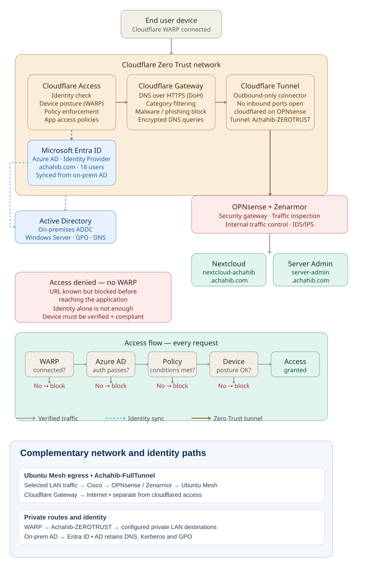

# Cloudflare Zero Trust — Home Lab Implementation

> **Stack:** Cisco · OPNsense + Zenarmor · cloudflared Tunnel · Ubuntu Cloudflare Mesh · WARP · Access / Gateway · Microsoft Entra ID  
> **Status:** ✅ Production — Running in Achahib Lab  
 > **Public edition:** addressing, hostnames and tenant details removed

---

## 🎯 Objective

Replace traditional VPN-based remote access with a modern **Zero Trust architecture** — where no user or device is trusted by default, even if it is inside the network.

Every access request is verified based on:
- **Identity** — who are you? (Azure AD)
- **Device** — is your device compliant? (WARP + device posture)
- **Context** — do you meet the access policy? (Cloudflare Access)

> *Never trust, always verify.*

---

## ❌ The Problem with Traditional VPN

| VPN | Zero Trust |
|---|---|
| Grants broad network access | Grants access only to specific apps |
| Once connected → user is "inside" | Identity + device verified every request |
| Large attack surface | No exposed services, no open ports |
| Network-based trust | Identity-based trust |

This lab combines application access policies with configured private network routes. Application Access rules and private network controls must be evaluated separately.

---

## 🏗️ Architecture

<div align="center">



</div>

> **Legend:** Solid lines = verified traffic · Blue dashed = identity sync · Orange = Zero Trust tunnel

**Key principle:** OPNsense establishes an **outbound-only** Cloudflare Tunnel. No inbound application ports are required for this cloudflared connector. Users cannot reach the services directly — they go through Cloudflare's identity layer first.

---

## Complementary connectivity paths

| Path | Connector | Purpose |
|---|---|---|
| Published applications / configured private routes | Application tunnel — cloudflared on OPNsense | Outbound-only connection to the LAN; no inbound application port forwarding |
| Selected LAN Internet egress | Ubuntu Mesh egress node — Ubuntu Cloudflare Mesh (formerly WARP Connector) | Cisco → OPNsense + Zenarmor → Ubuntu Mesh → Cloudflare Gateway → Internet |

AD remains the authority for internal AD domain, DNS, Kerberos and GPO. Microsoft Entra ID supplies cloud identity for Access. Remote domain services require the relevant private routes, DNS settings and firewall permissions. The public IP observed by websites depends on the egress/route mode.

The original application configuration below remains documented; private-route reachability is additional scope.

## 🔧 Components

### 1. Cloudflare Tunnel — `Application tunnel`

The tunnel connects my home lab to Cloudflare's network **without opening any inbound ports** on OPNsense or the ISP router.

- **Connector type:** cloudflared (running on OPNsense)
- **Status:** Reported healthy in the implementation evidence; uptime is a historical observation
- **Function:** All published app routes go through this tunnel

OPNsense acts as the security gateway — inspecting and filtering traffic before it reaches any internal service.

---

### 2. Published Application Routes

Internal applications are mapped to public subdomains through the tunnel:

| Route | Internal Service | Exposed? |
|---|---|---|
| `app.example.invalid` | Nextcloud instance | ❌ Not directly |
| `admin.example.invalid` | Admin portal | ❌ Not directly |

Each URL is accessible **only after passing Zero Trust policies** — not by network location.

> **Routing vs Access Control:**
> - Published Application Routes = *where* traffic goes (routing)
> - Applications = *who* can access it (identity + policy)

---

### 3. Cloudflare Access — Applications

Two self-hosted applications are protected by Zero Trust policies:

| Application | URL | Type |
|---|---|---|
| Nextcloud-achahib | `app.example.invalid` | Self-hosted |
| Server-Admin | `admin.example.invalid` | Self-hosted |

---

### 4. Access Policies

Two reusable policies control who can access each application:

| Policy | Action | Applied to |
|---|---|---|
| `Allow-With-WARP` | ALLOW | Requires WARP connected + identity match |
| `Zero Trust org` | ALLOW | Org-level identity verification |

Access follows the actual Include, Require and Exclude rules inside each policy. Separate Allow policies must not be assumed to combine into one mandatory identity-and-posture check.

---

### 5. Microsoft Entra ID (Azure AD) — Identity Provider

- **Tenant:** `example.invalid`
- **Users:** not publicly disclosed
- **Sync:** On-premises Active Directory → Azure AD (via AD Connect)

Users are managed locally in AD and validated in the cloud for Zero Trust authentication. Cloudflare Access uses Azure AD as the Identity Provider (IdP) — users must authenticate via Azure AD before accessing any protected application.

---

### 6. Cloudflare WARP — Device Agent

WARP is the client-side component installed on end-user devices. When connected:

- All DNS queries go through Cloudflare Gateway (encrypted DoH)
- Device posture is checked and reported
- The device is registered and linked to a user identity
- Traffic to internal apps is routed through Zero Trust network

**Device posture data collected:**
- OS version, Model, MAC address
- User ID linkage
- Last session timestamp

The device is trusted **only after verification** — not by network location.

---

### 7. Access Flow — What Actually Happens

```
User opens app.example.invalid
         │
         ▼
Cloudflare Access intercepts the request
         │
         ▼
Is WARP connected?  ──No──► ❌ ACCESS DENIED (Forbidden)
         │
        Yes
         ▼
Authenticate via Azure AD (Sign in with Microsoft)
         │
         ▼
Does identity match policy?  ──No──► ❌ ACCESS DENIED
         │
        Yes
         ▼
Does device meet posture requirements?  ──No──► ❌ ACCESS DENIED
         │
        Yes
         ▼
✅ Traffic forwarded through Cloudflare Tunnel → OPNsense → Nextcloud
```

---

### 8. Access Denied — Implementation validation

When a device without WARP connected tries to access `app.example.invalid`:

> **Result:** Cloudflare Access blocks the request with `403 Forbidden` before it ever reaches the internal network.

This proves that:
- The URL alone is **not enough**
- Identity alone is **not enough**
- **Both** device posture AND identity must pass

---

## 🔐 Security Posture

| Layer | Control | Status |
|---|---|---|
| Network | No inbound application port forwarding for cloudflared published apps | ✅ |
| Tunnel | Outbound-only Cloudflare Tunnel | ✅ |
| DNS | Gateway DoH filtering | ✅ |
| Identity | Azure AD authentication | ✅ |
| Device | WARP device posture check | ✅ |
| Policy | Per-application access rules | ✅ |
| Inspection | OPNsense + Zenarmor on internal traffic | ✅ |

---

## 📝 Lessons Learned

- **Cloudflare Tunnel avoids inbound port forwarding for its published applications** — no attack surface on the WAN side
- **Device posture is critical** — identity alone can be compromised; device state adds a second factor
- **Azure AD as IdP** integrates seamlessly with Cloudflare Access — hybrid AD (on-prem + cloud) works well for this setup
- **OPNsense + Cloudflare Tunnel** is a powerful combination — OPNsense handles internal security while Cloudflare handles external access control
- **Segmentation remains necessary** — application policies do not by themselves prevent lateral movement; private network routes also require scoped authorization and firewall controls.

---

## Separate OpenVPN remote-access path

The lab also operates a [separate on-premises OpenVPN remote-access system](../network/secure-remote-access.md) reached through a VPS relay over WireGuard with BGP route exchange. Its clients use VPS-side Cloudflare WARP for internet egress. This does **not** mean OpenVPN sessions are brokered by Cloudflare Access or the cloudflared application tunnel.

---

## 🔗 Related

- [Lab Architecture Overview](/README.md)
- [PacketFence NAC](../network/packetfence/README.md)
- [Centralized Automated Backup](../backup/urbackup/README.md)
