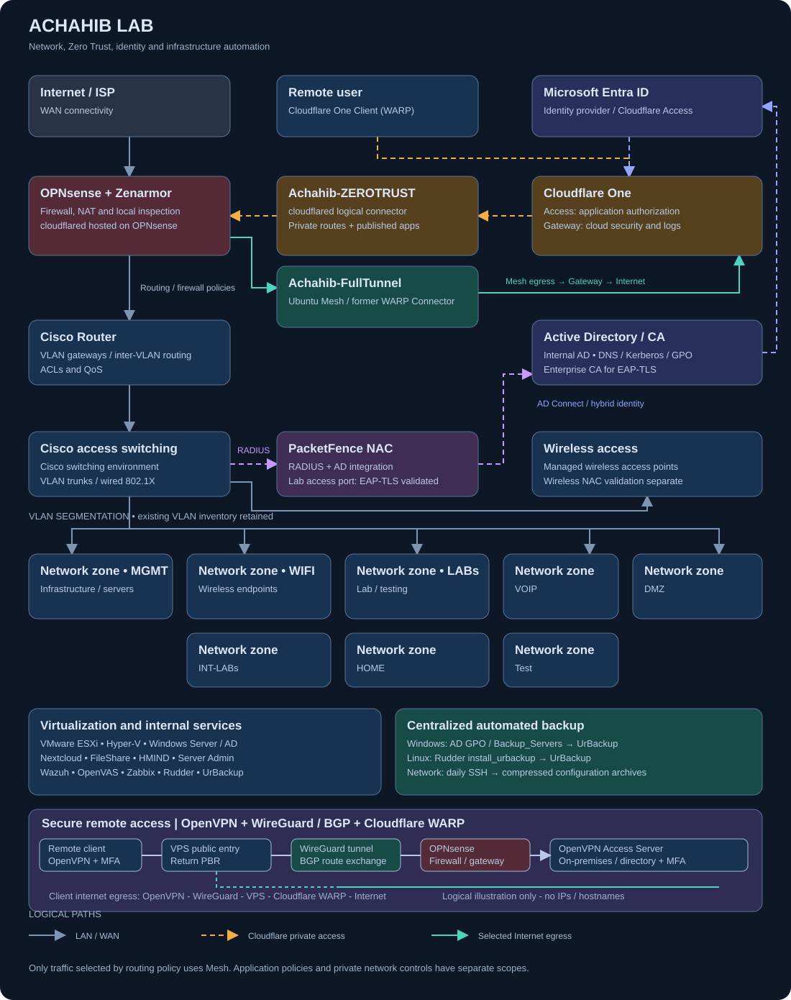

<div align="center">

# 🏗️ Achahib Lab

**A production-grade home lab simulating enterprise-level networking, security, virtualization, and cloud infrastructure.**

[](.)
[](.)
[](.)
[](.)
[](.)
[](.)

</div>

---

## 👤 About

Hi, I'm **Hamza** — an IT Engineer based in Morocco with **5+ years of experience** in networking, system administration, and cybersecurity. This repository is the central documentation hub for **Achahib Lab** — a fully self-hosted, enterprise-simulated environment covering network security, identity management, SIEM, vulnerability management, hybrid cloud, and infrastructure automation.

> *"Built to learn by doing — every component here mirrors a real enterprise deployment scenario."*

---

## 🗺️ Lab Architecture

<div align="center">



</div>

> **Public-facing logical diagram:** firewall, routing, cloud access, encrypted tunnels and service zones. Actual IP addresses, hostnames, ports, subnet IDs and management-plane details are deliberately omitted.

**Secure remote-access path:** Remote OpenVPN client → public VPS endpoint → WireGuard tunnel → OPNsense → on-premises OpenVPN Access Server. The VPS provides an inbound relay; the home ISP's address is not the advertised VPN endpoint.

**VPN user internet egress:** OpenVPN full tunnel → on-premises routing → WireGuard → VPS → Cloudflare WARP → Internet. Outbound websites see the Cloudflare WARP egress address rather than the VPS's original public address.

**Routing separation:** A narrowly scoped policy-routing rule returns OpenVPN transport traffic via the VPS public network interface; ordinary permitted egress uses WARP. BGP exchanges designated lab routes over WireGuard. Cloudflare Tunnel / Access and the Ubuntu Mesh egress path are **separate** architectures.

**Engineering case study:** [OpenVPN + WireGuard + Cloudflare WARP: asymmetric-routing resolution](network/secure-remote-access.md)

---

## 📋 Segmentation Overview

| Zone | Purpose |
|---|---|
| Management | Administration and infrastructure services |
| Wireless | Wireless endpoints |
| Labs | Isolated engineering and test workloads |
| Voice | IP telephony |
| DMZ | Segregated published services |
| Home / Test | Personal and transient testing workloads |

> VLAN identifiers, subnet assignments and access-control details are intentionally withheld from this public repository.

---

## 📂 Documentation Layout

The tree below is the planned documentation layout; only published sections are linked in the index that follows.

```
achahib-lab/
├── 📁 network/
│   ├── opnsense/             # OPNsense + Zenarmor configs (sanitized)
│   ├── cisco-router/         # Inter-VLAN routing, ACLs, QoS
│   ├── cisco-switch/         # VLAN trunking, 802.1X port configs
│   ├── packetfence/            # ISE policies, RADIUS, NAC profiles
│   └── diagrams/             # Network topology diagrams
├── 📁 vlans/
│   ├── vlan-table.md         # Full VLAN documentation
│   └── acl-policies/         # Inter-VLAN ACL rules
├── 📁 vpn/
│   ├── wireguard/            # WireGuard OPNsense client config
│   ├── openvpn/              # OpenVPN server setup & auth
│   └── double-tunnel/        # OpenVPN / WireGuard / WARP documentation
├── 📁 zero-trust/
│   ├── cloudflare-warp/      # WARP client deployment & policies
│   ├── ztna-apps/            # Application access policies (on-prem)
│   └── gateway-dns/          # DoH policies, category filtering
├── 📁 security/
│   ├── wazuh/                # SIEM rules, agents, dashboards
│   ├── openvas/              # Scan configs, reports, remediation
│   └── zenarmor/             # IDS/IPS policies, SNI rules
├── 📁 virtualization/
│   ├── esxi/                 # VMware ESXi setup, VM inventory
│   └── hyper-v/              # Hyper-V configs, VM templates
├── 📁 servers/
│   ├── windows-server/       # AD, DNS, DHCP, GPO configurations
│   ├── azure/                # Hybrid AD, Azure AD Connect setup
│   ├── nextcloud/            # Nextcloud deployment, SSL, automation
│   └── zabbix/               # Monitoring templates, alert rules
├── 📁 automation/
│   ├── rudder/               # Rudder policies, Linux automation
│   └── scripts/              # Bash/Python utility scripts
├── 📁 backup/
│   └── urbackup/             # UrBackup server config, schedules
└── 📁 docs/
    ├── reports/              # PDF lab reports
    └── write-ups/            # Project write-ups & lessons learned
```

---

### Published documentation

- [Cloudflare Zero Trust](Cloudflare%20Zero%20Trust/cloudflare-zero-trust-setup.md)
- [PacketFence NAC implementation](network/packetfence/README.md)
- [Centralized automated backup](backup/urbackup/README.md)
- [HMIND Chat Agent](hmind%20AI%20Agent/chat-agent.md)
- [HMIND HNTA](hmind%20AI%20Agent/hnta.md)
- [HMIND HSOC](hmind%20AI%20Agent/hsoc.md)
- [HMIND Networking](hmind%20AI%20Agent/networking.md)

## 🧩 Lab Components

### 🔐 Network Security & Edge

| Component | Role | Key Features |
|---|---|---|
| **OPNsense** | Edge Firewall / Gateway | NAT, DoH gateway, VLAN routing, WireGuard client |
| **Zenarmor** | NGFW Plugin | IDS/IPS, SNI inspection, app-layer control, TLS inspection |
| **Cisco Router** | Distribution Layer | Inter-VLAN routing, ACLs, QoS, policy enforcement |
| **Cisco Switch** | Layer 2 Core | VLAN trunking, port segmentation, 802.1X enforcement |
| **PacketFence** | NAC / AAA | AD integration, RADIUS, wired 802.1X EAP-TLS; lab access switch validated on Cisco Catalyst |

---

### ☁️ Zero Trust & Cloud Access

| Component | Role | Key Features |
|---|---|---|
| **Cloudflare WARP** | Zero Trust Client | Encrypted tunnel to Cloudflare network from any device |
| **Cloudflare ZTNA** | App Access (Zero Trust) | Access on-prem applications without exposing them to internet |
| **Cloudflare Gateway** | Cloud Security | DNS/network/web policies, filtering and centralized logs |
| **Achahib-ZEROTRUST** | cloudflared on OPNsense | Outbound-only connector for published applications and configured private routes |
| **Achahib-FullTunnel** | Ubuntu Cloudflare Mesh node | Formerly WARP Connector; configured LAN Internet egress through Cloudflare |
| **Microsoft Entra ID** | Cloudflare identity provider | Hybrid identity with on-prem AD; Access policy authentication |

**Remote access:** WARP client → Cloudflare Access / configured private routes → Achahib-ZEROTRUST (cloudflared on OPNsense) → internal services. Access policies protect the configured applications; no inbound application port forwarding is required.

**Cloudflare Internet egress:** Selected LAN traffic → Cisco VLAN gateway → OPNsense + Zenarmor → Ubuntu Mesh node (Achahib-FullTunnel) → Cloudflare Gateway → Internet. Routing policy determines which networks use this path; existing VPN and other egress paths remain separate.

**Identity and domain services:** On-prem AD (`internal AD domain`) synchronizes with Microsoft Entra ID. AD remains responsible for DNS, Kerberos and GPO; Cloudflare provides secure connectivity and access controls. Public source IP behavior depends on the selected egress mode.

---

### 🔒 VPN Architecture

| Component | Role | Key features |
|---|---|---|
| **OpenVPN Access Server** | On-prem remote-access server | Full-tunnel client profile, directory-backed authentication and MFA |
| **OPNsense** | On-prem security gateway | Firewall rules, route selection, inter-zone access |
| **WireGuard** | Site-to-cloud encrypted tunnel | VPS-to-home-lab transport |
| **FRRouting / BGP** | Dynamic routing | Route exchange for designated lab networks |
| **VPS** | Public entry point and routing gateway | OpenVPN UDP forwarding, carefully scoped return-path policy |
| **Cloudflare WARP on VPS** | Internet egress | Outbound traffic exits through WARP |
| **systemd** | Routing rule persistence | Ensures the dedicated OpenVPN return-path rule is installed at service startup |

**Important:** The original issue was asymmetric routing: OpenVPN requests reached the on-premises server, but server replies returned through Cloudflare WARP instead of the VPS public interface. Source-port-specific policy routing fixed the return path without globally bypassing WARP.

See the [sanitized implementation case study](network/secure-remote-access.md). This is a conceptual overview; sensitive commands and exact targeting details are intentionally excluded.

---

### 📊 Monitoring & SIEM

| Component | Role | Key Features |
|---|---|---|
| **Wazuh** | SIEM / EDR | Log ingestion, intrusion detection, FIM, compliance |
| **Zabbix** | Infrastructure Monitoring | Real-time metrics, dashboards, alerting |
| **OpenVAS** | Vulnerability Scanner | Network-wide scans, CVE analysis, remediation |

---

### 🖥️ Virtualization & Servers

| Component | Role | Key Features |
|---|---|---|
| **VMware ESXi** | Primary Hypervisor | Bare-metal virtualization, HA, VM management |
| **Hyper-V** | Secondary Hypervisor | Multi-system simulations, Windows-native VMs |
| **Windows Server (ADDC)** | Identity & Directory | Active Directory, DNS, DHCP, GPO |
| **Azure Cloud** | Hybrid Cloud | Azure AD Connect, hybrid identity integration |
| **Nextcloud** | Private Cloud Storage | Self-hosted file sharing, internal SSL, automation |

---

### ⚙️ Automation & Backup

| Component | Role | Key Features |
|---|---|---|
| **Rudder** | Config Management | Linux automation, compliance policies, drift detection; install_urbackup technique |
| **UrBackup** | Backup Solution | Centralized server backups; Windows deployment via GPO / Backup_Servers, Linux via Rudder |
| **SSH backup automation** | Network configuration archive | Daily cron jobs from UrBackup server; Cisco running configs and firewall XML, compressed archives and success/error logs |

---

## 🚀 Key Projects

### ✅ Completed

- **[DNS over HTTPS Gateway]** — OPNsense + Cloudflare Gateway enforcing network-wide DoH with category-based DNS filtering
- **[Zero Trust Remote Access]** — Cloudflare WARP + ZTNA replacing traditional VPN — on-prem apps accessible without port forwarding
- **[Secure Remote Access + WARP Egress](network/secure-remote-access.md)** — OpenVPN Access Server behind OPNsense, WireGuard/BGP to VPS, WARP internet egress, and a resolved asymmetric-return routing incident
- **[802.1X NAC with PacketFence](network/packetfence/README.md)** — AD-integrated RADIUS with EAP-TLS validated on lab access switch / Cisco Cisco Catalyst a test access port; broader role/VLAN and wireless validation remains separate
- **[VLAN Segmentation]** — segmented VLANs with full inter-VLAN ACL policy enforcement
- **[Hybrid AD (On-prem → Azure)]** — Azure AD Connect syncing on-premises AD to Azure AD
- **[Centralized SIEM with Wazuh]** — Log collection from all components with custom detection rules
- **[Infrastructure Monitoring]** — Zabbix dashboards covering all network and server components

- **[Cloudflare Mesh Egress](Cloudflare%20Zero%20Trust/cloudflare-zero-trust-setup.md)** — Ubuntu Mesh node for the selected LAN Internet path, alongside cloudflared private access
- **[Centralized Automated Backup](backup/urbackup/README.md)** — Windows via AD GPO, Linux via Rudder, and daily SSH network configuration archives

### 🔨 In Progress

| Project | Description |
|---|---|
| `HMIND SecOps Platform` | AI-powered SOC automation with incident response workflows |
| `Jarvis AI Assistant` | Self-hosted AI assistant with tool-calling capabilities |
| `OpenVAS Automation` | Scheduled scans + auto-reporting pipeline |
| `Rudder Full Coverage` | Full Linux fleet automation with compliance policies |

---

## 🎓 Certifications

| Certification | Status |
|---|---|
| CCNA | ✅ Completed |
| CCNP Security — SCOR 350-701 | ✅ Completed |
| Microsoft AZ-900 | ✅ Completed |
| NDG Linux / Intro to Cybersecurity | ✅ Completed |
| PCCSE (Prisma Cloud) | 🔄 In Progress |
| AZ-700 (Azure Security Engineer) | 🔄 In Progress |

---

## ⚠️ Security Notice

This is a **sanitized public portfolio**, not an operational runbook. Deliberately excluded: public and private IPs, CIDR blocks, hostnames, interface and port mappings, routing identifiers, user/device counts, keys, credentials, token values and production firewall rules. Conceptual flows are presented for educational use; do not infer that all lab networks use one egress path.

---

## 📬 Connect

- 💼 [LinkedIn](www.linkedin.com/in/hamza-a-8117b51a8)
- 🐙 [GitHub](https://github.com/hamzachi)

---

<div align="center">

*Every component in this lab was deployed, broken, debugged, and redeployed — that's how real learning happens.*

</div>
